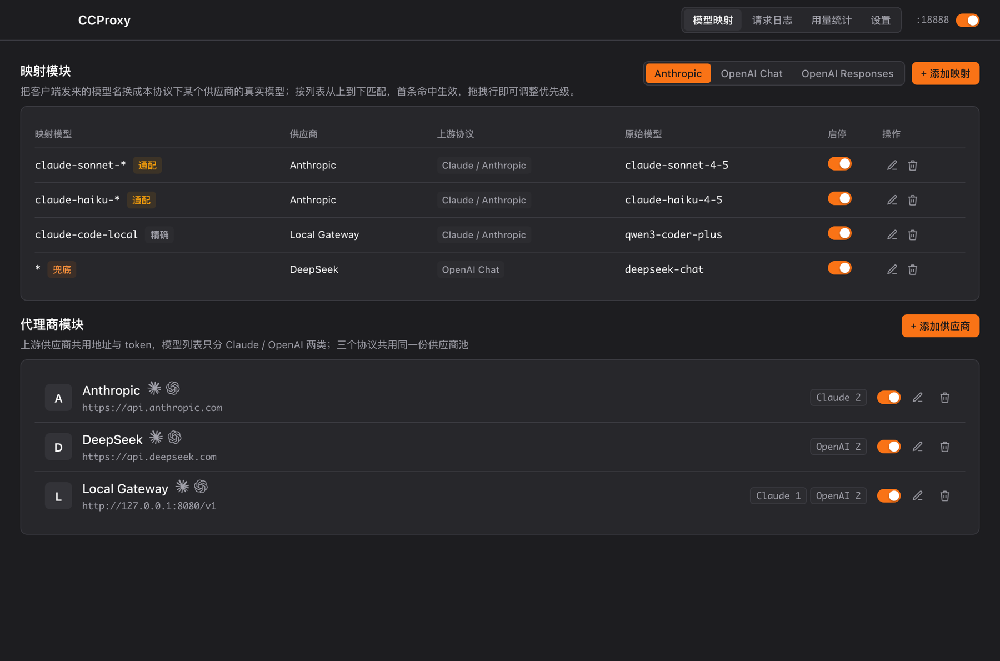
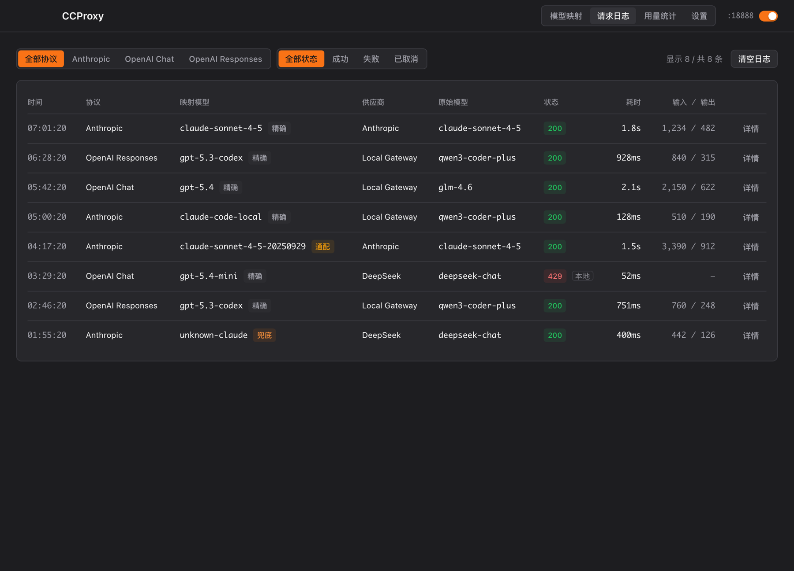
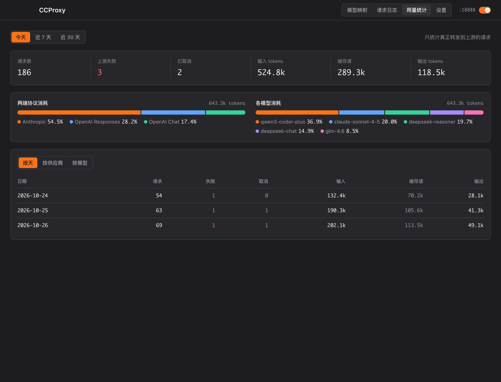
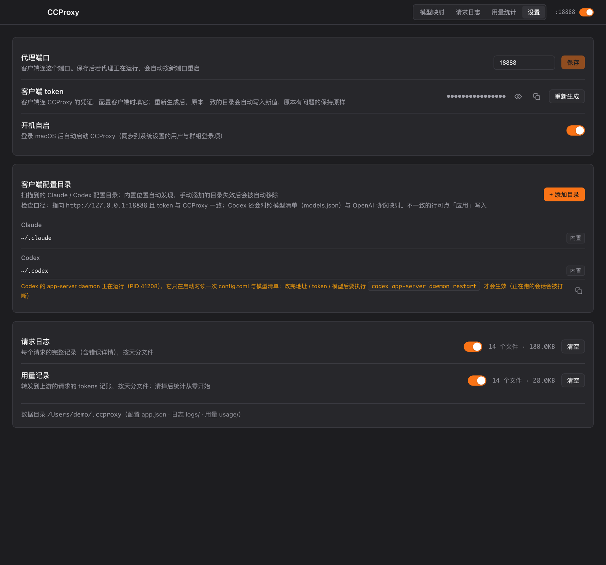

# CCProxy

CCProxy 是一个面向 Claude Code、Codex 等 AI Agent 客户端的本地协议代理。它只监听一个端口，
根据请求路径识别 Anthropic Messages、OpenAI Chat 或 OpenAI Responses，再按映射把客户端模型名、
供应商地址和凭据换成真实配置；需要时还会在三种线格式之间转换，并把响应改回客户端认识的样子。

界面基于 Tauri v2 + Rust + Vue 3，配置、日志和用量都在本机，不经过额外的云端控制面。



> 截图使用演示数据。模型名、供应商地址和 token 均非真实配置。

## 它解决什么问题

Claude Code 和 Codex 通常只认自己的协议、base URL 和模型名。想同时接入 Anthropic、DeepSeek、
智谱、本地网关等不同上游时，常见做法是给每个客户端重复改配置，还要手工处理协议和模型名差异。

CCProxy 把这些收在一处：

- 所有客户端统一连接 `http://127.0.0.1:18888`
- 供应商、真实凭据和模型清单集中维护
- 客户端继续使用稳定的模型名，由映射表决定实际路由
- Anthropic、OpenAI Chat、OpenAI Responses 可以按需互转
- 对 Claude Code / Codex 的精确映射，可把项目批量绑定到该映射的默认模型
- 请求日志和 tokens 用量按天、协议、供应商、模型汇总
- 一键把 CCProxy 地址和 token 写入已发现的 Claude / Codex 配置目录

## 核心能力

- **单端口、多协议**：同一个端口接收三种线格式，不要求客户端加路径前缀。
- **全局供应商池**：同一供应商只配置一次，三个协议共享地址、token 和模型列表。
- **规则化模型映射**：按列表顺序匹配，支持精确、前缀通配和 `*` 兜底。
- **项目级默认模型**：Anthropic / Responses 的精确映射可批量绑定 Claude / Codex 项目，
  自动同步项目配置中的默认 `model`，不接管项目连接配置。
- **协议适配**：按上游格式注入认证、改写端点和模型名，再把响应模型名改回客户端侧名称。
- **流式响应**：SSE 边收边转，不需要等完整响应；非流式响应的 tokens 也会记录。
- **可观测性**：请求日志包含协议、命中规则、供应商、真实模型、状态码、耗时和 tokens。
- **客户端配置托管**：自动发现 `~/.claude`、`~/.codex` 和 Xcode 内置配置目录，只改由
  CCProxy 管理的那部分，并在写入前保留备份。
- **托盘常驻**：关闭窗口不退出，代理继续运行；从菜单栏图标可重新打开或彻底退出。

## 工作方式

```text
Claude Code / Codex / OpenAI SDK
              │
              │  POST /v1/messages
              │  POST /v1/chat/completions
              │  POST /v1/responses
              ▼
        127.0.0.1:18888
              │
       识别客户端协议
              ▼
        读取 clientModel
              │
       按映射表首条命中
              ▼
  供应商 + 真实模型 + 上游协议 + token
              │
   改写模型 / 按需转换请求格式
              ▼
           上游 API
              │
   转换响应 / 回写客户端模型名
              ▼
     返回原客户端协议格式
```

映射表从上到下匹配，第一条可用规则生效。拖拽行即可调整优先级。

| 规则 | 示例 | 行为 |
|---|---|---|
| 精确 | `claude-sonnet-4-5` | 只匹配完全相同的模型名 |
| 通配 | `claude-sonnet-*` | 匹配该前缀下的模型名 |
| 兜底 | `*` | 匹配所有剩余请求；通常放在最后一条 |

协议、供应商和单条映射都可以单独停用。停用的规则会被跳过，未命中的请求返回 `404`。

### 协议转换矩阵

| 客户端格式 ↓ / 上游格式 → | Anthropic | OpenAI Chat | OpenAI Responses |
|---|---|---|---|
| Anthropic | 原样转发 | 支持转换 | 支持转换 |
| OpenAI Chat | 暂不支持 | 原样转发 | 暂不支持 |
| OpenAI Responses | 支持转换 | 支持转换 | 原样转发 |

### 项目默认模型

Anthropic 和 OpenAI Responses 下的精确映射会显示项目图标。点击后打开的独立窗口会从本机
Claude / Codex 会话记录中找出候选项目，支持批量绑定；模型固定使用当前映射的客户端模型名。

- Claude 项目写入项目级 `.claude/settings.local.json`
- Codex 项目写入项目级 `.codex/config.toml`
- 只修改默认 `model`，不接管项目连接配置
- 移除绑定不会删除项目配置；映射模型变化后，已有绑定会自动同步

## 快速开始

### 1. 启动应用

从 Release 下载 macOS 安装包，或从源码运行：

```bash
npm install
npm run tauri:dev
```

应用启动时会自动拉起代理。顶栏右侧显示监听端口和运行开关；默认地址是
`http://127.0.0.1:18888`。

### 2. 添加供应商

打开“模型映射”页，在“代理商模块”中添加供应商：

- 名称：用于界面识别
- Base URL：上游 API 根地址，例如 `https://api.deepseek.com`
- Token：供应商真实凭据
- 模型列表：分别维护 Claude / Anthropic 和 OpenAI 两类模型

模型组会用于选择真实模型、读取上下文窗口，并生成 Codex 的 `models.json` 清单。

### 3. 配置模型映射

切换到客户端实际使用的协议标签页，添加类似下面的规则：

| 客户端模型 | 供应商 | 上游协议 | 真实模型 |
|---|---|---|---|
| `claude-sonnet-*` | Anthropic | Claude / Anthropic | `claude-sonnet-4-5` |
| `claude-code-local` | Local Gateway | Claude / Anthropic | `qwen3-coder-plus` |
| `*` | DeepSeek | OpenAI Chat | `deepseek-reasoner` |

如果只是替换模型名，选择与客户端相同的上游协议即可；只有需要跨协议时才选择不同的格式。

### 4. 接入客户端

打开“设置”页，CCProxy 会扫描 Claude / Codex 的配置目录。发现配置与当前地址或 token 不一致时，
点击对应行的“应用”即可写入；原文件会保留 `.ccproxy-bak` 备份。

Claude Code 手动配置的位置是 `~/.claude/settings.json`：

```json
{
  "env": {
    "ANTHROPIC_BASE_URL": "http://127.0.0.1:18888",
    "ANTHROPIC_AUTH_TOKEN": "sk-在CCProxy设置页复制"
  }
}
```

Codex 手动配置的位置是 `~/.codex/config.toml`：

```toml
model_provider = "ccproxy"
model_catalog_json = "/Users/你的用户名/.codex/models.json"

[model_providers.ccproxy]
name = "ccproxy"
base_url = "http://127.0.0.1:18888/v1"
wire_api = "responses"
requires_openai_auth = false
experimental_bearer_token = "sk-在CCProxy设置页复制"
```

Codex 的 app-server daemon 只在启动时读取一次磁盘配置。若 daemon 正在运行，修改地址、token 或
模型清单后需要执行：

```bash
codex app-server daemon restart
```

## 支持的入口

| 路径 | 客户端协议 | 说明 |
|---|---|---|
| `/v1/messages*` | Anthropic | 包含 `/v1/messages/count_tokens` |
| `/v1/chat/completions` | OpenAI Chat | OpenAI Chat Completions |
| `/v1/completions`、`/v1/embeddings` | OpenAI Chat | 按同族线格式转发 |
| `/v1/responses` | OpenAI Responses | Codex 使用的 Responses API |
| `GET /v1/models*` | Anthropic / OpenAI | 由 CCProxy 按当前映射表直接生成 |

不认识的路径会直接返回 `400`，不会盲目转发到上游。

## 日志与用量



请求日志会显示一次请求从识别到上游响应的完整路径，包括命中的规则、供应商、真实模型、
状态码、耗时和 tokens。客户端主动取消会单独标记，不会被当作上游失败。



用量页只统计真正转发到上游的请求，支持今天、近 7 天、近 30 天，并可切换按天、供应商或模型查看。
输入 tokens 已包含缓存读写；缓存读作为明细单独展示。

## 设置与数据



| 内容 | 位置 |
|---|---|
| 应用配置 | `~/.ccproxy/app.json` |
| 请求日志 | `~/.ccproxy/logs/YYYY-MM-DD.jsonl` |
| 用量记录 | `~/.ccproxy/usage/YYYY-MM-DD.jsonl` |
| 运行日志 | `/tmp/ccproxy/app.log` |

配置采用原子写：先写临时文件再替换目标文件。配置损坏时会备份原文件、恢复默认配置并记录原因。
窗口关闭后进程仍在托盘运行；要停止代理并退出，请使用菜单栏图标中的“退出 CCProxy”。

## 常见问题

**端口被占用**

默认端口 `18888` 已被其他进程使用。到设置页换一个端口，运行中的代理会自动重启。

**返回 `404 mapping_not_found`**

当前协议的映射表没有匹配请求中的 `model`。检查客户端协议标签页是否正确，并在最后添加一条
`*` 兜底规则。

**返回 `400 unknown_path`**

客户端 base URL 或接口路径不正确。Claude Code 应使用 `/v1/messages` 一族路径，Codex 应使用
`/v1/responses`。

**Codex 配置已更新但行为没变**

执行 `codex app-server daemon restart`。已在运行的 app-server 不会自动重读 `config.toml`
和 `models.json`。

**首次打开被 macOS 拦截**

当前发布包使用 ad-hoc 签名且未公证。可在“系统设置 → 隐私与安全性”中选择“仍要打开”，或执行：

```bash
xattr -dr com.apple.quarantine /Applications/CCProxy.app
```

## 开发

需要 Node.js 21+、Rust 工具链和 Tauri 的 macOS 构建依赖。

```bash
npm install
npm run dev          # 只启动 Vite，适合调界面
npm run tauri:dev    # 启动完整 Tauri 应用
npm test             # cargo test：单元测试和端到端测试
npm run build        # 只构建前端
npm run tauri:build  # 打包 .app / .dmg
./scripts/rebuild.sh # 只打包 .app
./scripts/install.sh # 安装到 /Applications
```

目录速览：

```text
src/                    Vue 3 界面、Pinia stores、Tauri IPC 桥
src-tauri/src/proxy/    协议识别、路由、适配、上游转发
src-tauri/src/convert/  Anthropic / Chat / Responses 请求与 SSE 转换
src-tauri/src/clients/  Claude / Codex 配置检查、改写和 models.json 同步
src-tauri/tests/        Rust 单元与代理端到端测试
```

## 文档

- [设计文档](docs/superpowers/specs/2026-09-21-ccproxy-design.md)：请求管线、路由规则与数据模型
- [Electron → Tauri 迁移记录](docs/2026-10-14-electron-to-tauri.md)：模块映射、行为差异、分发与 CI
- [协议转换设计](docs/superpowers/specs/2026-10-15-protocol-conversion-design.md)：跨协议请求、响应与流式转换
